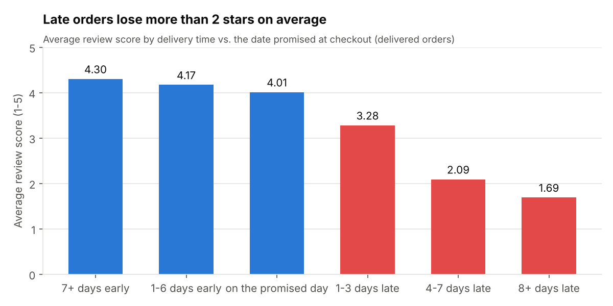
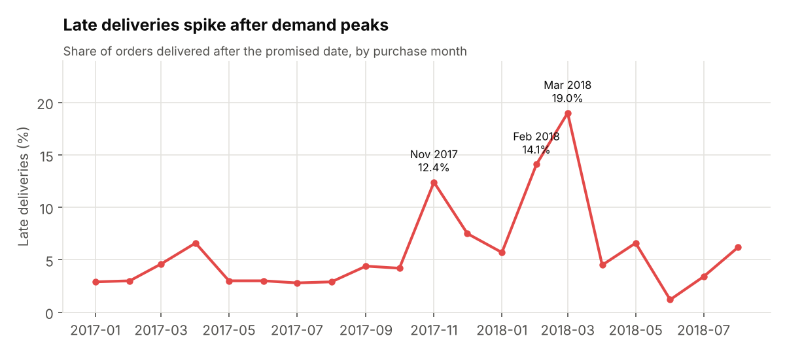
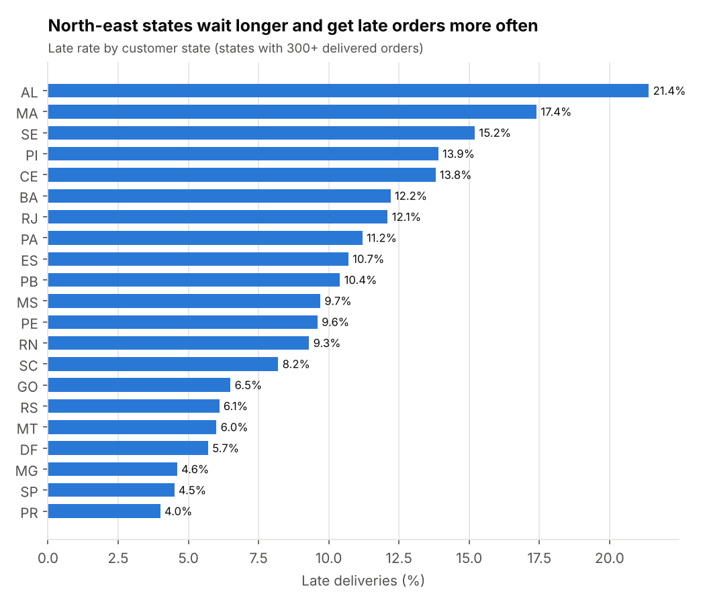
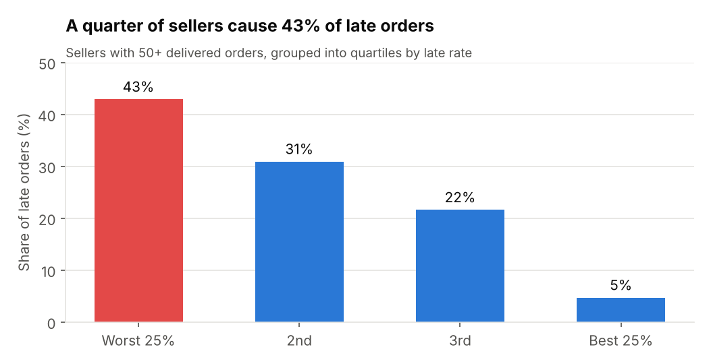

# Olist Delivery & Seller Performance Analysis

How do delivery times affect customer satisfaction on a marketplace, and where do late deliveries come from?

This project takes ~100k real orders from **Olist**, a Brazilian e-commerce marketplace (2016–2018), builds a small data pipeline and star schema around them, and answers six business questions with SQL.

**Stack:** Python (pandas) · DuckDB (SQL) · matplotlib · Chart.js

**▶ [Interactive dashboard](https://sevvalokyy.github.io/olist-delivery-analytics/)** – late-rate trend with a state filter, seller quartiles and the regional view.

---

## Key findings

**1. A late delivery costs more than two stars.** Orders that arrived 7+ days early averaged **4.30 / 5**; orders 8+ days late averaged **1.69**. The share of 1–2 star reviews jumps from **9%** to **80%**. Even 1–3 days late pulls the average down to 3.28.



**2. The checkout promise is padded, yet 6.8% of orders still miss it.** Customers are promised **24.4 days** on average but receive orders in **12.5 days**; 92% arrive early. The padding hides how slow delivery really is, and still does not protect the late tail.

**3. Late deliveries spike after demand peaks.** The late rate jumps to **12.4%** for November 2017 orders (Black Friday) and reaches **19.0%** in March 2018, against a usual 3–6%.



**4. Region matters.** Customers in the north-east wait 19–25 days on average, and up to **21% of orders in Alagoas (AL)** arrive late. São Paulo (SP), where most sellers are, gets orders in 8.7 days with a 4.5% late rate.



**5. A small group of sellers drives a large share of the problem.** Among sellers with 50+ delivered orders, the worst quartile (107 sellers) has an **11.3%** late rate versus **2.1%** for the best quartile, and accounts for **43%** of all their late orders.



**6. Repeat purchases are rare, and lower after a bad first experience.** Only **3.5%** of customers ever order again. Customers whose first order was late came back at **2.8%**, compared with **3.6%** for on-time first orders. (This is a correlation, not proof of cause.)

**7. Revenue is concentrated.** 18 of 74 product categories bring in **80%** of revenue, led by health & beauty, watches & gifts, and bed, bath & table.

## Recommendations

- **Set delivery promises by region,** not one padded estimate. Tighter, honest dates in the south-east would look better to customers; the north-east needs more realistic ones.
- **Put the worst-quartile sellers on a late-rate target,** with a monthly scorecard (query 04 can be scheduled as-is). Fixing ~100 sellers addresses ~40% of late orders.
- **Plan carrier capacity before peaks** such as Black Friday, when late rates triple.
- **Contact customers proactively when an order is going to be late.** The review score drops sharply after the promised date, so this is the moment to act.

---

## Data model

Raw CSVs are cleaned in Python and loaded as staging tables, then [`sql/schema.sql`](sql/schema.sql) builds a star schema:

```
                 dim_date
                    |
  dim_customer - fact_orders - fact_order_items - dim_product
                                       |
                                   dim_seller
```

| Table | Grain | Main columns |
|---|---|---|
| `fact_orders` | one order | delivery_days, promised_days, days_vs_promise, is_late, items_value, payment_value, review_score |
| `fact_order_items` | one item in an order | order_id, product_id, seller_id, price, freight_value |
| `dim_customer` | one customer_id | customer_unique_id, city, state |
| `dim_seller` | one seller | city, state |
| `dim_product` | one product | category (English), weight, volume |
| `dim_date` | one day | year, quarter, month, weekend flag |

**Data quality issues handled in the ETL** ([`etl/load.py`](etl/load.py)):
- Some orders have several reviews and some review IDs repeat → kept the latest review per order.
- Orders paid in several parts (e.g. voucher + card) → rolled up to one payment row per order.
- 610 products have no category → labelled `unknown`; category names translated to English.
- Misspelled source columns (`product_name_lenght`) renamed.
- Undelivered orders keep NULL delivery dates and are excluded from delivery metrics.

## Analyses

| # | Question | SQL techniques |
|---|---|---|
| [01](sql/analysis/01_late_delivery_vs_review.sql) | How much does lateness hurt review scores? | CTE, CASE bucketing, window share of total |
| [02](sql/analysis/02_monthly_growth.sql) | Month-over-month orders, revenue, late rate | `LAG()`, named window, `FILTER` |
| [03](sql/analysis/03_delivery_by_state.sql) | Which states get the slowest deliveries? | CTE, `HAVING`, `RANK()` |
| [04](sql/analysis/04_seller_scorecard.sql) | Which sellers cause late orders? | `NTILE(4)`, `SUM() OVER ()` |
| [05](sql/analysis/05_repeat_purchase_cohorts.sql) | Do customers come back after a late order? | `ROW_NUMBER()`, `LEAD()` |
| [06](sql/analysis/06_category_pareto.sql) | Which categories drive revenue? | running total with `ROWS BETWEEN` |

Query outputs are saved in [`results/`](results/).

## How to run

1. Download the dataset from [Kaggle – Brazilian E-Commerce Public Dataset by Olist](https://www.kaggle.com/datasets/olistbr/brazilian-ecommerce) and unzip the CSVs into `data/raw/`.
2. Install dependencies and run the pipeline:

```bash
pip install -r requirements.txt
python etl/load.py        # builds olist.duckdb
python run_analyses.py    # runs sql/analysis/*.sql, writes results/
python make_charts.py     # writes images/
python make_dashboard.py  # writes docs/index.html (GitHub Pages)
```

## Limitations

- The data covers Sept 2016 – Oct 2018; months at both ends have very few orders and are left out of trend charts.
- "Late" is measured against Olist's own estimated date, not a fixed SLA.
- Repeat-purchase differences are observational; other factors (region, category) could explain part of the gap.

## Next steps

- Seller-level drill-down in the dashboard (individual seller scorecards).
- Add seller–customer distance from the geolocation table to separate distance from seller behaviour.
